<picture>
  <source media="(prefers-color-scheme: light)" srcset="https://raw.githubusercontent.com/mtayyab-10/mtayyab-10/main/assets/hero-light.svg" />
  
</picture>

<picture>
  <source media="(prefers-color-scheme: light)" srcset="https://readme-typing-svg.demolab.com?font=JetBrains+Mono&weight=500&size=18&pause=1400&color=059669&center=true&vCenter=true&width=640&height=36&lines=Scalable+web+applications;Autonomous+agents+and+n8n+automations;Founder+of+Devixaweb;Teaching+code+to+a+global+classroom" />
  
</picture>

  
  
  
  

## About

I build scalable web applications, n8n automations and autonomous agents. Founder of Devixaweb, shipping production-grade software and workflow solutions. Computer science student at FAST-NUCES, class of 2028, and an educator teaching students aged 8 to 12 across Canada, the United States, Pakistan and India. Open-source builder with published research.

<table width="100%">
<tr>
<td width="25%" align="center" valign="top"><b>Best Open-Source AI Project</b> HacktoberFest '26</td>
<td width="25%" align="center" valign="top"><b>Founder</b> Devixaweb, since December 2024</td>
<td width="25%" align="center" valign="top"><b>Two papers</b> Published on Zenodo, September 2026</td>
<td width="25%" align="center" valign="top"><b>Educator</b> Global cohorts, ages 8 to 12</td>
</tr>
</table>

## Education

<table width="100%">
<tr>
<td width="30%" valign="top"><b>FAST-NUCES</b> August 2024 to June 2028 (expected)</td>
<td width="70%" valign="top">Bachelor of Science in Computer Science Core engineering foundations, system design, data structures and artificial intelligence, with hands-on frontend and backend work. Focus on clean architecture, algorithmic efficiency and scalable web solutions.</td>
</tr>
<tr>
<td width="30%" valign="top"><b>Lawrence College, Ghora Gali, Murree</b> August 2022 to June 2024</td>
<td width="70%" valign="top">Higher Secondary School Certificate, Pre-Engineering. Grade A, First Division Pre-Engineering studies at Pakistan's premier historic boarding institution (est. 1860). Built a rigorous foundation in advanced mathematics, physics and analytical problem-solving, along with residential leadership and competitive sports.</td>
</tr>
<tr>
<td width="30%" valign="top"><b>Faisalabad Grammar School</b>November 2010 to April 2022</td>
<td width="70%" valign="top">Elementary and junior secondary education English-medium foundation in mathematics, sciences, language arts and computer literacy.</td>
</tr>
</table>

## Experience

<table width="100%">
<tr>
<td width="30%" valign="top"><b>Devixaweb</b> Founder and Lead Full-Stack Developer December 2024 to present · Remote</td>
<td width="70%" valign="top"><ul><li>Designed and launched full-stack web platforms with React, Node.js and PostgreSQL, focused on reliability and responsive interfaces.</li><li>Automated business operations with custom integrations, n8n workflows and autonomous agents.</li></ul></td>
</tr>
<tr>
<td width="30%" valign="top"><b>Junior Coderz</b> STEM Trainer, part-time March 2026 to present · Remote</td>
<td width="70%" valign="top"><ul><li>Teach Python and logic building to students aged 8 to 12 across Canada, the United States, Pakistan and India.</li><li>Guide hands-on coding projects, track progress and give constructive feedback within a structured curriculum.</li></ul></td>
</tr>
<tr>
<td width="30%" valign="top"><b>DevWeekends</b> Engineering Fellow June 2026 to July 2026</td>
<td width="70%" valign="top"><ul><li>Selected for a competitive engineering fellowship under senior technical mentorship, building scalable full-stack applications with rigorous code reviews and agile practices.</li></ul></td>
</tr>
</table>

## Certificates

| Certificate | Issuer | Focus |
|---|---|---|
| **Hacktoberfest 2026 Fest Winner** | Hacktoberfest | Best Open-Source AI Project, awarded for TrueNorth at Hack Day Faisalabad x Himmatkaar |
| **Build AI Agents with n8n** | Edureka | Multi-agent systems, vector databases, conversational memory, tool orchestration |
| **Google AI Professional Certificate** | Google | Generative AI tools, practical deployment, productivity |
| **n8n 101 Certificate** | n8n | Workflow automation, branching, data mapping, webhooks |
| **Intro to Claude AI** | Scrimba | Claude API integrations, multimodal prompts, error handling |
| **National AI Hackathon 2026** | atomcamp | Rapid prototyping of AI-driven solutions |

Google AI course series (seven courses)

 

- AI Fundamentals
- AI for Content Creation
- AI for App Building
- AI for Data Analysis
- AI for Writing and Communicating
- AI for Research and Insights
- AI for Brainstorming and Planning

## Publications

1. **M. Tayyab**, "Comparative Benchmarking of Constraint Satisfaction Heuristics and Genetic Algorithms for Multi-Criteria Timetable Optimization". Zenodo, 5 September 2026. [doi:10.5281/zenodo.22333734](https://doi.org/10.5281/zenodo.22333734)
2. **M. Tayyab**, W. Hassan and Umaima, "Predicting Systolic Blood Pressure in Cardiovascular Patients: A Comparative Analysis of Multiple Linear Regression and Random Forest". Zenodo, 5 September 2026. [doi:10.5281/zenodo.22545270](https://doi.org/10.5281/zenodo.22545270)

## Projects

| Project | What it does | Stack |
|---|---|---|
| **[ChatAlmanac](https://github.com/mtayyab-10/chatalmanac)** | A fully private, browser-based WhatsApp chat analyzer. Deep insights, statistics and user comparisons with zero data leaving your device. | `TypeScript` |
| **[TrueNorth](https://github.com/mtayyab-10/truenorth)** | Winner of Best Open-Source AI Project at Hacktoberfest Hack Day Faisalabad x Himmatkaar. <!-- edit: add what it does --> | `Add stack` |
| **[AI EvidenceLens](https://github.com/mtayyab-10/evidencelens)** | Multimodal claim validation and decision brief generator. Open source. | `Python` `Streamlit` `Gemini` |
| **[Zenclox](https://github.com/mtayyab-10/zenclox-app)** | Installable Pomodoro timer with zero dependencies: progress ring, five dark themes, ambient soundscapes and session analytics. | `JavaScript` `Web Audio` |
| **[AI Timetable Optimizer](https://github.com/mtayyab-10/AI-Timetable-Optimizer)** | Constraint solver for university course timetables using maintained arc consistency and min-conflicts. Benchmarked against genetic algorithms in a [published paper](https://doi.org/10.5281/zenodo.22333734). | `Python` |
| **[TrueHire AI](https://github.com/mtayyab-10/truehire-ai)** | <!-- edit: add a one-line description --> Add description. | `Add stack` |
| **[Blood Pressure Estimator](https://github.com/mtayyab-10/blood-pressure-estimator)** | Predicts systolic blood pressure in cardiovascular patients, comparing multiple linear regression and random forest. See the [published paper](https://doi.org/10.5281/zenodo.22545270). | `Regression` `Random forest` |

## Skills

<table width="100%">
<tr>
<td width="22%" valign="middle"><b>Frontend</b></td>
<td valign="middle"></td>
</tr>
<tr>
<td width="22%" valign="middle"><b>Backend and data</b></td>
<td valign="middle"></td>
</tr>
<tr>
<td width="22%" valign="middle"><b>Languages</b></td>
<td valign="middle"></td>
</tr>
<tr>
<td width="22%" valign="middle"><b>Agents and automation</b></td>
<td valign="middle">
  
  
  
  
  
</td>
</tr>
<tr>
<td width="22%" valign="middle"><b>Tools</b></td>
<td valign="middle"></td>
</tr>
<tr>
<td width="22%" valign="middle"><b>Foundations</b></td>
<td valign="middle">Data structures and algorithms · Constraint solving · Machine learning · Prompt engineering · Data analysis</td>
</tr>
</table>

## Activity

  <picture>
    <source media="(prefers-color-scheme: light)" srcset="https://raw.githubusercontent.com/mtayyab-10/mtayyab-10/output/github-snake.svg" />
    
  </picture>

